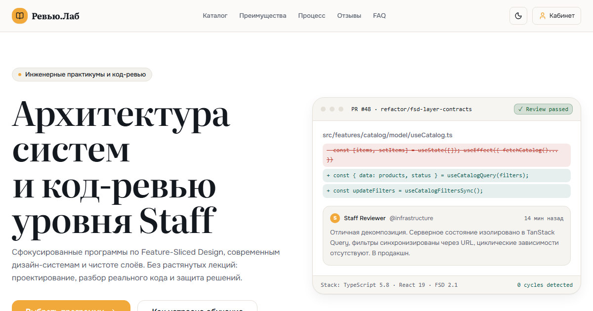

# Ревью.Лаб — витрина курсов

Каталог образовательных продуктов: курсы, воркшопы и консультации по frontend-архитектуре
с корзиной, оформлением доступа и личным кабинетом. Демо-проект — оплата не проводится,
авторы, отзывы и рейтинги вымышлены.

**Демо:** [course-showcase-tau.vercel.app](https://course-showcase-tau.vercel.app)



## Что есть на сайте

- Каталог с вкладками по типу продукта, поиском, фильтром по уровню и сортировкой.
  Фильтры хранятся в URL, ссылкой на подборку можно поделиться.
- Карточка продукта в модальном окне: программа, автор, формат.
- Оформление доступа: промокоды, валидация полей, выбор способа оплаты, экраны успеха и
  ошибки (демо-шлюз: `DEV20` даёт скидку 20 %, email с `fail` показывает ошибку оплаты).
- Личный кабинет с заказами (вход без пароля, `student@example.com` — пример с заказом).
- Квиз подбора трека, отзывы, FAQ, страницы оферты и политики конфиденциальности.
- Светлая и тёмная тема, адаптивная вёрстка, `prefers-reduced-motion`.
- SEO: Open Graph, JSON-LD (`ItemList` из `Course`).

## Стек

- React 19, React Router 7, TypeScript в строгом режиме
- Vite 6, Tailwind CSS 4 с дизайн-токенами (`src/styles/tokens.css`)
- Vitest + happy-dom, ESLint 9, Prettier
- GitHub Actions: typecheck, lint, format, build и тесты на каждый PR
- Деплой на Vercel

## Архитектура

Слои по Feature-Sliced Design, границы проверяет ESLint (`no-restricted-imports`):
слой импортирует только нижележащие, фичи не импортируют друг друга.

```text
src/
├── app/         # роутинг, каркас страницы, секции главной, страницы
├── features/    # catalog, checkout, account
├── entities/    # session — пользователь и его заказы
├── shared/      # UI-кит, мок-API, утилиты, конфиг
└── styles/      # токены и базовые стили
```

Связь фич собирается в `app/MainLayout.tsx`: например, оформление доступа открывает
кабинет через проп, а не импортом другой фичи.

## Как сделано

Проект собран с помощью Claude Code: я ставил задачи агенту, разбирал предложенные решения
и проверял результат в браузере — на десктопе, мобильной ширине и в тёмной теме. Код держится
в рамках проверок: строгий TypeScript, ESLint, Prettier, unit-тесты и CI на каждый PR.

Перед публикацией в портфолио провёл с агентом аудит готового сайта и исправил найденное
отдельными PR:

- [#2](https://github.com/KufuVampire/course-showcase/pull/2) — неотформатированный код,
  CI не проверял ветку `dev` и форматирование;
- [#3](https://github.com/KufuVampire/course-showcase/pull/3) — модальное окно оставалось на
  странице после закрытия браузером (Escape), `/oferta` и `/privacy` отдавали 404 на Vercel;
- [#4](https://github.com/KufuVampire/course-showcase/pull/4) — фичи импортировали из слоя
  `app`: сессия вынесена в `entities`, границы слоёв закреплены правилом ESLint;
- [#5](https://github.com/KufuVampire/course-showcase/pull/5) — название, похожее на
  существующую школу, отсутствие пометок о демо-режиме, нет OG-картинки.

## Запуск

```bash
npm install
npm run dev           # dev-сервер
npm run typecheck     # проверка типов
npm run lint          # ESLint
npm run format:check  # Prettier
npm test              # тесты
npm run build         # продакшн-сборка
```

## Лицензия

MIT, см. [LICENSE](./LICENSE).
